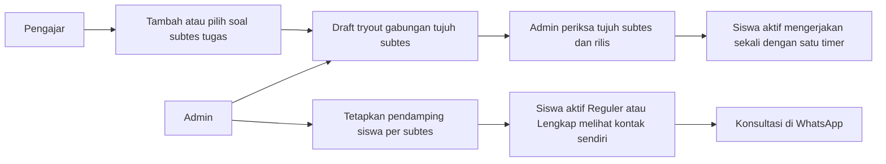

# Aktor dan Akses Cendekia Muda

Pembaruan: **9 November 2026**. Acuan target: [PRD](../assets/PRD.md) dan [ERD](../ERD/ERD-Cendekia-Muda-revisi.drawio). Dokumen ini menggantikan pembagian dua role pada 7 November. **Frontend tiga role sudah diterapkan** di [script.js](../script.js), [js/core.js](../js/core.js), dan [js/management.js](../js/management.js). Fondasi Node.js + Express sudah tersedia untuk frontend dan health endpoint; API bisnis, PostgreSQL, dan otorisasi server masih tahap berikutnya.

## Aktor, akun, dan penugasan

| Pihak | Fungsi | Akun portal |
| --- | --- | --- |
| Pengunjung | Informasi publik dan registrasi siswa | Tidak ada |
| Siswa | Belajar, transaksi, hasil, dan kontak pendamping pribadi | `siswa` |
| Pengajar | Materi, video, bank soal, dan kontribusi draft tryout pada subtes tugasnya | `pengajar`, dibuat admin |
| Admin | Seluruh pengelolaan, penugasan pengajar/pendamping, pemeriksaan dan rilis tryout | `admin`, dibuat pengelola |
| Pendamping | Membimbing siswa melalui WhatsApp | Tidak ada; kontak dan penugasan dikelola admin |
| Payment Gateway | Memproses pembayaran dan mengirim status | Sistem eksternal, bukan akun portal |

Ada **tiga role login**. Gratis/Aktif bukan role baru; keduanya status siswa yang dihitung dari pendaftaran. Pengajar dan pendamping berbeda fungsi. Seorang siswa dapat mempunyai beberapa pendamping untuk subtes berbeda; admin menentukan pembagiannya, siswa tidak memilih sendiri. Default satu penugasan pendamping aktif per siswa–subtes dijelaskan di PRD.

## Akses dan batas pengelolaan

| Fitur | Siswa Gratis | Aktif Reguler | Aktif Lengkap | Pengajar | Admin |
| --- | --- | --- | --- | --- | --- |
| Profil dan kata sandi | Sendiri | Sendiri | Sendiri | Sendiri | Sendiri |
| Program dan transaksi siswa | Sendiri | Sendiri | Sendiri | Tidak | Kelola program dan monitoring seluruh transaksi |
| Konten bertanda gratis | Ya | Ya | Ya | Kelola subtes tugas | Kelola semua |
| Pembahasan lengkap dan PDF berbayar | Terkunci | Ya | Ya | Kelola subtes tugas | Kelola semua |
| Video berbayar | Terkunci | Terkunci | Ya | Kelola subtes tugas | Kelola semua |
| Mengerjakan/review tryout | Terkunci | Sesuai jadwal, sekali pengerjaan | Sesuai jadwal, sekali pengerjaan | Tidak sebagai siswa | Tidak sebagai siswa |
| Ringkasan latihan/tryout agregat per subtes | Tidak | Tidak | Tidak | Subtes tugas aktif, baca saja; tanpa identitas/nilai individu | Laporan admin yang sudah tersedia |
| Draft tryout bersama | Tidak | Tidak | Tidak | Lihat tujuh subtes; ubah soal subtes tugas | Kelola semua |
| Membuat paket, jadwal, durasi, rilis tryout | Tidak | Tidak | Tidak | Tidak | Ya |
| Kontak Pendamping Saya | Terkunci | Penugasan sendiri | Penugasan sendiri | Tidak | Kelola kontak dan penugasan |
| Akun pengajar dan tugas subtes | Tidak | Tidak | Tidak | Lihat tugas sendiri | Kelola semua |

Pengunjung hanya mengakses halaman publik. Konten gratis tetap membutuhkan login siswa. Menu video siswa mengikuti program dengan akses video; materi video yang secara eksplisit gratis dapat dipratinjau melalui materi gratis sesuai PRD. Program berakhir mengunci konten premium dan kontak pendamping, tetapi tidak menghapus hasil atau penugasan.

Pengajar dapat ditugaskan pada satu atau lebih subtes. Dalam subtes tugasnya, pengajar boleh mengelola konten bersama, termasuk karya pengajar lain. Simpan materi/video/bank soal langsung memublikasikan sesuai status aktif dan Gratis/Berbayar; tidak ada approval konten biasa. Pengajar tidak mendapat akses kontak siswa, transaksi, atau penugasan pendamping.

Pada layanan produksi, semua batas harus diperiksa di server, termasuk unduhan/stream file, perubahan subtes, URL langsung, dan payload yang dimanipulasi. Menyembunyikan tombol saja tidak cukup. Nama pembuat pada konten tidak menentukan izin; penugasan aktif yang menentukan.

## Login dan navigasi

| Area | Rute | Ketentuan |
| --- | --- | --- |
| Landing dan paket publik | `#/landing`, `#/landing#program` | Tanpa login |
| Registrasi | `#/auth/register` | Selalu menghasilkan siswa |
| Login siswa | `#/auth/login` | Kredensial siswa |
| Login pengajar | `#/auth/pengajar-login` | Kredensial pengajar; menuju `#/pengajar/dashboard` |
| Login admin | `#/auth/admin-login` | Kredensial admin; menuju `#/admin/dashboard` |
| Pemulihan | `#/auth/forgot-password`, `#/auth/reset-password?token=...` | Token valid, sekali pakai; prototype belum mengirim email |
| Program siswa | `#/siswa/program` | Tetap di sidebar, tidak dimasukkan ke dropdown profil |
| Transaksi siswa | `#/siswa/transaksi` | Dropdown profil → Pembayaran & Transaksi; milik sendiri |
| Pendamping Saya | `#/siswa/pendamping` | Rute baru; program aktif dan penugasan sendiri |

Login pengajar tidak memerlukan landing baru. Registrasi publik tidak menyediakan pilihan admin/pengajar. Pengguna yang sudah login dengan role berbeda tidak dapat masuk ke portal lain dengan mengganti URL.

Top bar siswa berisi ikon notifikasi dan avatar profil, **keduanya tetap membuka dropdown**. Notifikasi berisi pesan terbaru, status baca, dan Lihat Semua. Profil berisi Profil Saya/Ubah Profil, Pembayaran & Transaksi, Ubah Kata Sandi, Keluar; masing-masing aksi membuka tampilan yang sesuai. Ketiga item Profil, Notifikasi, dan Pembayaran dikeluarkan dari sidebar siswa. Pemilihan program dan checkout tetap halaman tersendiri.

Halaman pembayaran memisahkan Belum Dibayar dan Riwayat Transaksi dengan aksi lanjut/batal/coba lagi sesuai status. Monitoring pembayaran admin tetap ada pada portal admin.

Pengajar memiliki menu **Hasil Belajar** dengan ringkasan latihan dan tryout terpisah per subtes tugas aktif. Data bersifat agregat; bukan daftar nilai individu atau penugasan pengajar–siswa. Pengajar tidak dapat membuka ringkasan subtes lain atau mengubah nilai. Sumber data menggunakan tabel jawaban/hasil yang sudah ada; ERD tetap 16 tabel. Aturan perhitungan terdapat di PRD §7.2, dan hasil pemeriksaan di [audit ringkasan pengajar](AUDIT-RINGKASAN-PENGAJAR.md).

## Alur tryout dan pendamping

Semua pengajar mengisi paket bersama, bukan tryout terpisah per subtes. Di luar subtes tugasnya hanya baca. Status Rilis menutup perubahan pengajar, termasuk mengubah isi soal paket lewat bank soal; setelah ada pengerjaan, soal dan durasi dibekukan bagi semua pengelola. Konten soal yang sudah dipakai direvisi melalui soal baru agar hasil lama tidak berubah.

Pembayaran lunas tidak otomatis menetapkan pendamping. Jika belum ditugaskan, tampilkan bantuan admin. Pendamping tidak login dan aplikasi tidak menyimpan percakapan WhatsApp.

## ERD dan cakupan revisi

PRD target memuat **40 use case**, mempertahankan ID UC-01–UC-33 dan menambah UC-34–UC-40. ERD target memuat **16 tabel dan 27 foreign key**:

- Empat tabel baru: `subtes`, `pengajar_subtes`, `pendamping`, `siswa_pendamping`.
- `users.role` mendapat pengajar. `materi` dan `soal` mengacu pada master subtes, serta menyimpan pembuat/pengubah dan waktu perubahan.
- Materi menyimpan pilihan sumber tautan/unggahan dan metadata storage privat. Isi file tidak disimpan sebagai base64 di database.
- Tryout menyimpan admin pembuat/perilis; `tryout_soal` menyimpan urutan. Aturan penugasan, unique gabungan, pembekuan, dan transaksi dijelaskan pada PRD §12.3.
- Halaman pertama draw.io menampilkan seluruh 16 tabel; empat halaman detail memisahkan Akun dan Pendamping, Materi dan Bank Soal, Tryout dan Progress, serta Program dan Pembayaran. Kotak `[referensi]` bukan tabel tambahan.

Frontend telah menerapkan alur di atas dengan 16 koleksi browser dan pemeriksaan akses pada router/operasi JavaScript. File unggahan berada di IndexedDB browser; akun, kontak, dan data lokal dapat diperiksa lewat DevTools sehingga belum merupakan proteksi produksi. Migrasi lokal mempertahankan ID dan riwayat lama. Fondasi Express belum menerapkan aturan akses bisnis ini. Koneksi PostgreSQL, migrasi SQL, autentikasi dan otorisasi API Express, file privat, serta pengujiannya tetap pekerjaan berikutnya. Lihat [panduan backend](../server/README.md) dan [audit revisi frontend](AUDIT-REVISI-FRONTEND.md); hasil pengujian historis sebelumnya tetap mengacu pada versi saat masing-masing audit dilakukan.
