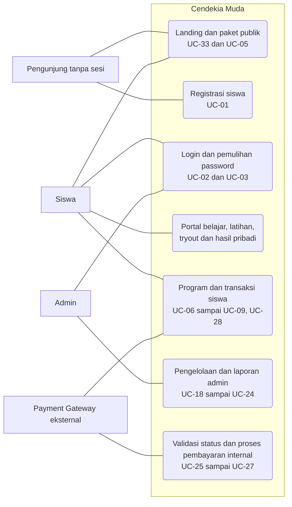

# Aktor dan Akses Cendekia Muda

Pembaruan: **7 November 2026**. Acuan: [PRD](../PRD.md), implementasi halaman di [script.js](../script.js), aturan akses di [js/core.js](../js/core.js), dan [ERD](../ERD/ERD-Cendekia-Muda-revisi.drawio).

## Aktor, akun, dan status akses

| Aktor | Kedudukan | Aktivitas utama | Role akun |
| --- | --- | --- | --- |
| Pengunjung | Pengguna tanpa sesi login; dapat belum punya akun atau sedang logout | Melihat informasi publik dan paket pada landing, melakukan registrasi | Tidak ada |
| Siswa | Pemilik akun belajar | Login, belajar, membeli program, mengerjakan latihan/tryout, melihat hasil pribadi | `siswa` |
| Admin | Pemilik akun pengelola | Login admin, mengelola siswa dan konten, memantau transaksi/laporan | `admin` |
| Payment Gateway | Sistem eksternal dalam rancangan pembayaran | Memproses pembayaran dan mengirim status kepada aplikasi | Tidak ada; tidak memakai login portal |

Dengan pembagian ini ada **tiga aktor manusia dan satu sistem eksternal**, tetapi hanya **dua role akun yang login**. Siswa Gratis dan Siswa Aktif merupakan status akses dari aktor Siswa yang sama. Aktif memerlukan pendaftaran Lunas yang sudah dimulai dan belum berakhir.

Pengunjung tidak perlu akun demo atau tabel tersendiri. Registrasi membuat baris `users` dengan role `siswa`; prototype langsung membuka sesi siswa Gratis setelah registrasi berhasil. Logout menghapus sesi, sehingga pengguna kembali mengakses aplikasi sebagai pengunjung. Admin dibuat oleh pengelola; formulir registrasi publik tidak menawarkan pilihan role.

**Syarat dosen belum terkonfirmasi:** pengunjung merupakan aktor dalam rancangan interaksi ini, tetapi belum ada kepastian bahwa dosen menerima pengunjung untuk syarat “minimal 3 aktor, dengan login”. Pertanyaan yang perlu diajukan: “Apakah Pengunjung tanpa login, Siswa dengan login, dan Admin dengan login memenuhi syarat, atau harus tiga role yang masing-masing login?”

## Halaman yang dapat dibuka tanpa sesi

| Halaman | Rute | Batas akses |
| --- | --- | --- |
| Landing | `#/landing` | Pengenalan platform, subtes, keunggulan, contoh cerita siswa, dan bagian kontak |
| Paket di landing | `#/landing#program` | Ringkasan harga dan fitur paket; CTA Pilih Program untuk pengunjung menuju registrasi |
| Registrasi | `#/auth/register` | Membuat akun siswa, bukan admin |
| Login siswa | `#/auth/login` | Memeriksa akun dengan role siswa |
| Login admin | `#/auth/admin-login` | Memeriksa akun dengan role admin; tautan juga tersedia di footer landing |
| Pemulihan password | `#/auth/forgot-password` | Prototype menampilkan tautan pemulihan lokal untuk akun yang ditemukan |
| Reset password | `#/auth/reset-password?token=...` | Form dapat dibuka tanpa sesi, tetapi perubahan password memerlukan token valid yang belum kedaluwarsa |

Konten gratis tetap membutuhkan login siswa. Halaman program lengkap, tabel perbandingan, dan FAQ di `#/siswa/program` berada dalam portal siswa. Link menuju halaman tersebut dari area publik tetap mengarahkan pengunjung ke login. Tombol WhatsApp bergantung pada nomor resmi dalam konfigurasi; jika kosong, yang muncul adalah dialog bantuan.

## Matriks akses portal

“Ya” berarti melalui halaman dan operasi aplikasi yang tersedia. Pembatasan saat ini dijalankan di browser sebagai prototype; implementasi backend nanti harus memeriksanya kembali di server.

| Fitur | Pengunjung | Siswa Gratis | Siswa Aktif Reguler | Siswa Aktif Lengkap | Admin |
| --- | --- | --- | --- | --- | --- |
| Landing dan paket publik | Ya | Ya | Ya | Ya | Ya |
| Profil, notifikasi, program, transaksi, dan progress siswa | Login dahulu | Milik sendiri | Milik sendiri | Milik sendiri | Tidak memakai portal siswa; kelola siswa/program dan pantau transaksi/laporan |
| Latihan soal dan materi bertanda gratis | Login dahulu | Ya | Ya | Ya | Dikelola melalui area admin |
| Pembahasan lengkap latihan | Login dahulu | Kunci/benar-salah saja | Ya | Ya | Pratinjau dan edit soal di area admin |
| Bank soal lengkap dan PDF berbayar | Login dahulu | Perlu program aktif | Ya | Ya | Dikelola melalui area admin |
| Menu Video Pembahasan (`#/siswa/video`) | Login dahulu | Terkunci | Terkunci | Ya | Dikelola melalui area admin |
| Pengerjaan dan review tryout | Login dahulu | Perlu program aktif | Ya, sesuai jadwal dan status pengerjaan | Ya, sesuai jadwal dan status pengerjaan | Kelola jadwal/soal dan lihat laporan |
| Halaman pengelolaan admin (`#/admin/...`) | Login admin dahulu | Tidak | Tidak | Tidak | Ya |

Perubahan akses program tidak menghapus riwayat latihan dan nilai. Setelah program berakhir, siswa tetap bisa login dan melihat hasil pribadi; konten berbayar dan review tryout kembali terkunci sesuai aturan PRD. Admin bukan akun siswa dengan paket yang lebih tinggi; akun admin mempunyai halaman pengelolaan tersendiri.

## Diagram interaksi ringkas

Diagram berikut merangkum hubungan aktor dengan fungsi utama. Rincian 33 use case dan relasi include/extend tetap mengacu pada PRD.

Proses penilaian, penyimpanan jawaban, validasi status pembayaran, dan aktivasi akses dijalankan di dalam aplikasi. Payment Gateway berada di luar batas sistem pada rancangan; pada prototype interaksinya digantikan tombol simulasi transaksi milik siswa. Admin memantau status pembayaran melalui laporan, tanpa verifikasi manual atau tombol simulasi di halaman monitoring.

## Penyesuaian use case

- **UC-01:** aktor registrasi diperjelas menjadi Pengunjung, dengan akses Publik. Hasilnya adalah akun siswa.
- **UC-02 dan UC-03:** form login/pemulihan bersifat publik untuk pemilik akun siswa/admin yang belum login; operasi berikutnya tetap memerlukan kredensial atau token yang valid.
- **UC-05:** Pengunjung melihat ringkasan paket di landing; Siswa mendapat halaman program dalam portal setelah login.
- **UC-33:** mendokumentasikan landing page dan informasi publik yang sudah tersedia.
- **UC-04 sampai UC-32:** nomor dipertahankan; label akses dan pemicu proses internal diperjelas. Semua rincian ada di tabel PRD, termasuk pembatasan konten berbayar dan kepemilikan data.

PRD sekarang memuat **33 use case**. Angka 32 pada arsip audit 3 November mengacu pada versi dokumen saat audit itu dilakukan, bukan jumlah terbaru.

## Kesesuaian ERD

ERD tetap memuat **12 tabel dan 12 relasi antartabel** sesuai model data PRD.

- Label kolom `users.role` diperjelas menjadi `role (siswa/admin)`.
- Tidak ada tabel/role baru untuk pengunjung atau gateway. Gateway direpresentasikan melalui informasi transaksi di `pembayaran`.
- Garis tambahan dari atribut `soal.pembahasan` ke `materi` dihapus karena tidak memiliki foreign key pendukung dan bertentangan dengan PRD yang menetapkan `materi` sebagai katalog bersama tanpa relasi langsung.
- Tabel `jawaban_latihan`, `hasil_tryout`, dan `jawaban_siswa` tetap menyediakan rancangan penyimpanan progress/hasil per siswa.

Perubahan diagram ini menyelaraskan dokumentasi dengan model yang sudah digunakan; data prototype dan struktur tabel tidak dimigrasikan. Pemeriksaan dilakukan dengan membandingkan entitas, atribut, dan pasangan relasi XML ERD terhadap PRD serta struktur data contoh.

## Catatan pemeriksaan

Dokumentasi diselaraskan berdasarkan pembacaan fungsi `landing`, `pricing`, `auth`, dan handler registrasi di `script.js`, serta `register`, `login`, `guard`, `materialAccess`, dan `enrollment` di `js/core.js`. Kode aplikasi, konfigurasi akun, dan hasil pengujian historis tidak diubah pada pekerjaan dokumentasi ini.

Pemeriksaan konsistensi memastikan 33 nomor use case unik dan berurutan, 12 tabel serta 12 relasi ERD sesuai PRD, dan tautan lokal pada dokumentasi yang diperbarui valid. `git diff --check` lulus. Pengujian aplikasi tidak dijalankan ulang karena perubahan hanya pada dokumentasi dan diagram ERD.
